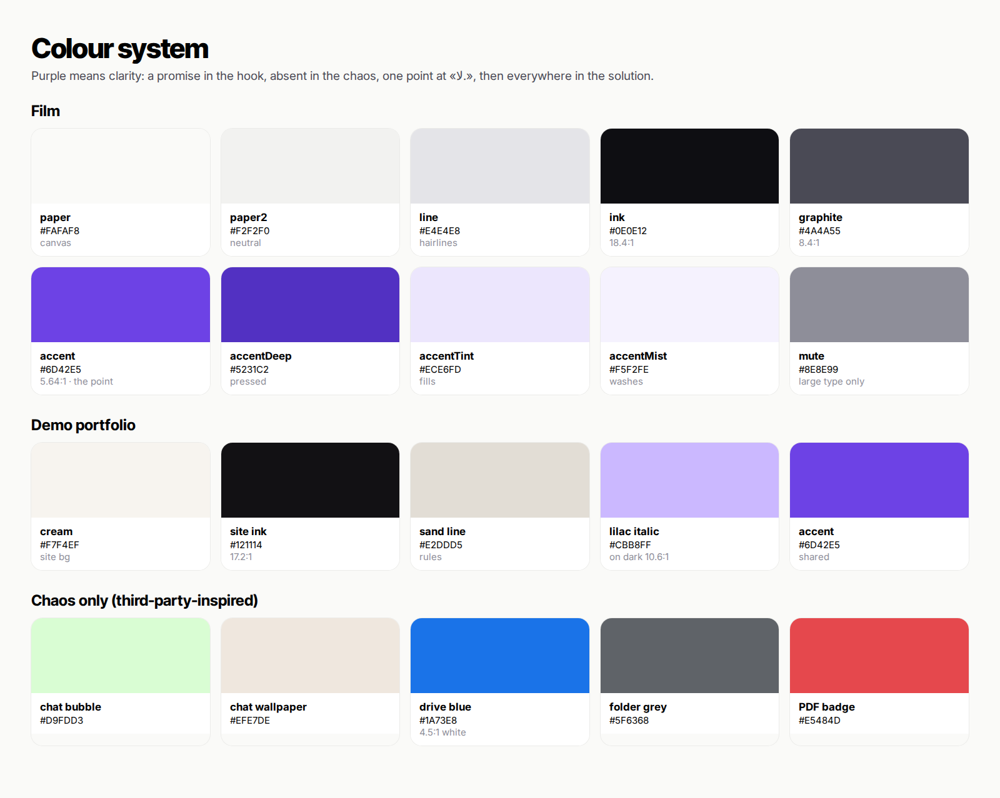

# 10 — Colour System

**Rule:** purple means clarity. It is present as a promise in the hook, completely absent in the chaos (where third-party app colours take over), returns as ONE point at «لا.», and then spreads into the words, the website and the CTA.

All tokens live in `src/config/theme.js` (JS) and `src/styles/base.css` (CSS custom properties). Contrast ratios below are measured (WCAG 2.x).

## Film palette (the ad)

| Token | Hex | Use | Contrast |
|---|---|---|---|
| `paper` | `#FAFAF8` | Canvas. Warm off-white, never pure white | — |
| `paper2` | `#F2F2F0` | Secondary light neutral | — |
| `line` | `#E4E4E8` | Hairlines | — |
| `ink` | `#0E0E12` | Primary type, stickers | 18.43:1 on paper |
| `graphite` | `#4A4A55` | Secondary type | 8.37:1 on paper |
| `mute` | `#8E8E99` | Tertiary / not-yet-spoken caption words (large type only) | 3.10:1 on paper |
| **`accent`** | **`#6D42E5`** | Brand violet: the point, solution emphasis, CTA | **5.64:1** on paper · white on accent 5.90:1 |
| `accentDeep` | `#5231C2` | Pressed state, text on tint | 6.71:1 on tint |
| `accentTint` | `#ECE6FD` | Soft fills | — |
| `accentMist` | `#F5F2FE` | Faint washes | — |

**Why this violet.** No brand file was supplied, so the purple was chosen on purpose rather than at random. It is OKLCH (0.53, 0.23, 288°): a true violet, not the blue-leaning "SaaS indigo" (≈250°) and not the neon Tailwind violet. It passes AA as text on the canvas, so the same token works for words, points and buttons. **To use your real brand purple, change `accent` in both `theme.js` and `base.css` (and `--accent-deep`/`tint`), then re-render.**

## Demo portfolio palette (inside the ad)

This is intentionally different from the film palette, so the portfolio reads as a distinct, custom-designed product rather than more ad graphics.

| Token | Hex | Use | Contrast |
|---|---|---|---|
| cream | `#F7F4EF` | Site background | — |
| site ink | `#121114` | Site type | 17.15:1 on cream |
| sand line | `#E2DDD5` | Section rules | — |
| site dark | `#121114` | Contact section | — |
| lilac italic | `#CBB8FF` | «together.» on dark | 10.61:1 on dark |
| accent | `#6D42E5` | Contact button, section numbers, «human» | shared with the film |

## Chaos palette (third-party-inspired, only 4.0–15.1 s)

These colours stand for other people's apps. Their job is to be recognizable and slightly noisy, and they never appear in the solution half.

| Use | Hex |
|---|---|
| Chat outgoing bubble | `#D9FDD3` |
| Chat wallpaper | `#EFE7DE` |
| Chat header | `#F0F2F5` |
| Drive-style blue (links, buttons) | `#1A73E8` (white on it 4.51:1) |
| Folder grey | `#5F6368` |
| File badges | PDF `#E5484D` · ZIP `#8E8E99` · DOC `#2F6FEB` · MP3 `#E5A000` · MP4 `#7C66DC` · MOV `#11A683` · PNG `#0EA5E9` |

## Imagery palette

The 3D stills carry warm material colour (amber, rosé, cream, sand) against the cool white and violet UI. The contrast between warm work and cool frame keeps the creator's work as the hero.

